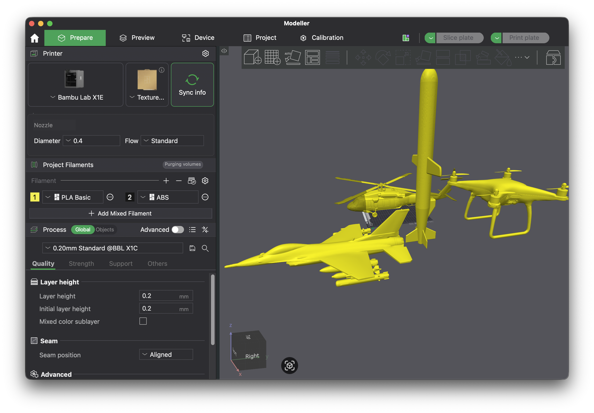

# CAD Tabanlı Sentetik Veri ve Model Geliştirme Yol Haritası

> **Durum:** Uygulama öncesi teknik yol haritası  
> **Kapsam:** Gerçek hedef fotoğrafları elde edilene kadar model geliştirme, CAD'den sentetik veri üretimi ve sonrasında sim-to-real geçişi  
> **Bağlayıcı kaynak:** [`docs/sartname_v4.pdf`](sartname_v4.pdf) ve güncel hedef/parkur bilgileri  
> **İlgili belgeler:** [`CAD_TABANLI_SENTETIK_VERI_IMPLEMENTASYON_PLANI.md`](CAD_TABANLI_SENTETIK_VERI_IMPLEMENTASYON_PLANI.md), [`adr/006-sahi-hailo-tiled-search.md`](adr/006-sahi-hailo-tiled-search.md), [`hedef_gorseli_yolo_veri_plani.md`](hedef_gorseli_yolo_veri_plani.md), [`hedef_ve_parkur_operasyon_guncellemesi.md`](hedef_ve_parkur_operasyon_guncellemesi.md), [`YAZILIM_DONANIM_UCTAN_UCA_ENTEGRASYON_PLANI.md`](YAZILIM_DONANIM_UCTAN_UCA_ENTEGRASYON_PLANI.md)



## 1. Yönetici özeti

### Kısa cevap

Evet, `Modeller.3mf` içindeki hedef geometrilerini **kamerayla çekilmiş gibi**
görüntüler üretmek için kullanabiliriz. Bunun doğru yöntemi ekran görüntüsü almak
değil; fizik tabanlı ışık, malzeme, kamera, hareket ve parkur simülasyonu kullanan
bir render hattı kurmaktır.

Ancak CAD renderları gerçek fotoğraf ihtiyacını tamamen ortadan kaldırmaz:

- **Şimdi:** CAD renderlarıyla veri hattını, sınıfları, etiketleri, takipçiyi,
  model eğitimini ve Hailo dönüşüm zincirini geliştirebiliriz.
- **Hedefler gelmeden önce:** Gerçek Camera Module 3 ile boş parkur/atölye,
  siyah perde, taşıyıcı, ray ve ışık koşullarını kaydedip CAD renderlarını bu
  gerçek arka planlara yerleştirebiliriz.
- **Hedefler geldiğinde:** Az ama bağımsız oturumlara ayrılmış gerçek çekimlerle
  fine-tuning, validation ve test yapılmalıdır.
- **Release:** Yalnız sentetik veriyle alınan sonuç modelin fiziksel yarışma
  ortamında kabul edildiği anlamına gelmez. `trainingAuthorized` ve
  `releaseCandidate` kapıları gerçek grup-ayrılmış test verisi gelene kadar kapalı
  kalmalıdır.

### Nihai strateji

```text
3MF CAD master
    ↓ doğrulama, isimlendirme, ölçek ve yön normalizasyonu
Render için sadeleştirilmiş mesh + PBR materyal
    ↓
1. Fizik tabanlı sentetik sahneler
2. Domain-randomized sahneler
3. Gerçek boş kamera görüntüsü + CAD hibrit sahneler
4. Hareketli sentetik video sekansları
5. `2304×1296` main görüntüden SAHI `8×768` arama tile'ları ve kare track ROI türevleri
    ↓ otomatik ve kusursuz bbox/mask/pose/ilişki etiketleri
Sentetik araştırma eğitimi ve ablation
    ↓
İlk gerçek hedef çekimleri
    ↓ gerçek veriyle fine-tuning + bağımsız real-only test
ONNX → HEF → Raspberry Pi 5 + Hailo-8 kabulü
```

## 2. Mevcut girdilerin teknik denetimi

### 2.1. `Modeller.3mf`

Dosya yerel olarak incelendi:

- Dosya: [`Modeller.3mf`](../Modeller.3mf)
- SHA-256: `9f696bf7aa8c5c0dc2fa1e733266e6e9c274494bc2f210c3bc40b8975fb47028`
- Sıkıştırılmış boyut: yaklaşık `26 MB`
- Paket açıldığında içerik: yaklaşık `168 MB`
- Üretici uygulama metadata'sı: `BambuStudio-02.05.00.66`
- Birim: `millimeter`
- Dört ayrı mesh: Füze, Helikopter, F16 ve Drone
- Paket üretim uzantısı ve Bambu Studio proje metadata'sı içeriyor.
- Mesh dosyalarında PBR materyal, doku veya yarışmadaki kırmızı/camgöbeği
  görünümü bulunmuyor. Ekrandaki sarı renk slicer görünümüdür; fiziksel hedef
  rengi olarak kullanılamaz.

| 3MF nesnesi | Kaynak adı | Mesh boyutu (mm) | En uzun eksen | Üçgen sayısı |
| --- | --- | ---: | ---: | ---: |
| Füze | `Füze.stl` | `105.1 × 218.9 × 500.0` | `500.0 mm` | `20,626` |
| Helikopter | `Helikopter.stl` | `392.5 × 582.7 × 178.4` | `582.7 mm` | `607,680` |
| F16 | `f16.stl` | `300.4 × 500.0 × 139.3` | `500.0 mm` | `687,994` |
| Drone | `Drone` | `287.5 × 375.0 × 195.1` | `375.0 mm` | `715,412` |

### 2.2. Kesin CAD ölçüleri

`docs/images/hedef_maket_bilgileri.png` içindeki değerler yaklaşık bilgilerdir.
Sentetik üretimde ve imal edilecek hedeflerde gerçek ölçü sözleşmesi
`Modeller.3mf` mesh sınırlarıdır:

| Nesne | Kesin mesh boyutu (mm) | En uzun eksen | Render ölçeği |
| --- | --- | ---: | ---: |
| F16 | `300.403 × 500.000 × 139.258` | `500.000 mm` | `1.000` |
| Helikopter | `392.467 × 582.673 × 178.363` | `582.673 mm` | `1.000` |
| Drone | `287.452 × 374.986 × 195.076` | `374.986 mm` | `1.000` |
| Füze | `105.132 × 218.899 × 500.000` | `500.000 mm` | `1.000` |

Kaynak CAD master değiştirilmez; manifest bu boyutları `VERIFIED` ve ölçek
katsayısını `1.0` olarak taşır.

### 2.3. CAD dosyasının eksikleri

CAD geometrisi güçlü bir başlangıçtır ancak tek başına kamera görüntüsü değildir.
Eksik fiziksel değişkenler:

- gerçek baskı/imalat malzemesi ve yüzey pürüzlülüğü;
- kırmızı ve camgöbeği hedeflerin kamera altındaki ölçülmüş rengi;
- katman çizgileri, boya farkı, çizik, toz ve baskı kusurları;
- hedef taşıyıcı, ray, bağlantı ipi ve kırmızı balon;
- parkurun siyah duvar/perde kıvrımları ve zemin yansımaları;
- Camera Module 3 gerçek intrinsics, distortion, exposure, gain, autofocus ve
  görüntü işleme davranışı;
- hareket kaynaklı blur, olası rolling-shutter etkisi ve video sıkıştırması.

### 2.4. Yüksek poligon riski

Helikopter, F16 ve Drone meshleri yaklaşık `0.6–0.7 milyon` üçgen içeriyor.
Binlerce sahnenin tekrar tekrar renderlanması için bu gereksiz derecede ağırdır.
Master meshler korunarak şu seviyeler üretilmelidir:

- `LOD0`: Kaynak master; yalnız arşiv ve yakın görsel kontrol.
- `LOD1`: Orta ayrıntı; 1–5 m geliştirme renderları.
- `LOD2`: Uzak hedef; özellikle 5/10/15 m için düşük poligon.

15 m'de birkaç düzine piksele düşen bir hedef için yüz binlerce üçgen kullanmak
görüntü bilgisini artırmaz. LOD dönüşümü sonrası siluet farkı ve izdüşüm bbox
farkı otomatik test edilmelidir.

## 3. Ne işe yarar, ne işe yaramaz?

### Kullanılabilir

1. **PBR CAD renderı:** Gerçek ışık, gölge, materyal ve perspektif ile RGB
   görüntüsü üretmek.
2. **Domain randomization:** Işık, yüzey, kamera, arka plan ve pozları kontrollü
   değiştirerek modelin tek bir render stilini ezberlemesini engellemek.
3. **Hibrit kompozisyon:** Gerçek Camera Module 3 ile çekilmiş boş parkur
   karelerine renderlanan hedefleri derinlik/gölge uyumuyla eklemek.
4. **Kusursuz otomatik etiket:** Render motorundan bbox, instance mask, görünürlük,
   sınıf, pose, hedef merkezi ve balon ilişkisini doğrudan almak.
5. **Hareketli sekans:** Aşama 2/3 için ray hareketi, motion blur, kısmi görünme,
   parkurdan çıkma ve yeniden edinme senaryosu üretmek.
6. **Klasik algoritma baseline'ı:** CAD maskelerinden siluet/template/Hu moment
   yaklaşımını YOLO ile karşılaştırmak.
7. **Hard-negative üretimi:** Kırmızı/camgöbeği kablo, stand, kıyafet, tabela,
   perde kıvrımı ve gölge gibi yanlış pozitif kaynaklarını sahneye eklemek.

### Kullanılmamalı

1. Bambu Studio ekran görüntülerini doğrudan eğitim görüntüsü yapmak.
2. Hedefi hep sarı, aynı açıdan veya boş gri fonda renderlamak.
3. Dört CAD nesnesinin yakın kopyalarını train ve test'e rastgele dağıtmak.
4. Üretken görsel modeline hedef resmi çizdirip etiketini gerçek kabul etmek.
5. Sentetik test sonucunu gerçek parkur başarısı olarak raporlamak.
6. Renk randomization sırasında kırmızıyı camgöbeğine veya ara belirsiz renklere
   kaydırıp dost/düşman sözleşmesini bozmak.

## 4. Neden ekran görüntüsü yerine fizik tabanlı render?

Ekran görüntüsü aşağıdaki sabit ipuçlarını modele öğretir:

- slicer'ın sarı materyali ve gri arayüz zemini;
- düzgün ve yapay kenar yumuşatma;
- tek tip stüdyo ışığı;
- gerçek kamerada olmayan keskinlik ve kontrast;
- aynı kamera açısı ve aynı nesne yerleşimi.

Fizik tabanlı render ise kamera ışınlarını, malzeme yansımasını, gölgeyi,
perspektifi, alan derinliğini ve hareketi sahne içinde üretir. Ardından gerçek
kamera kaynaklı noise, blur, distortion ve sıkıştırma post-process olarak
eklenebilir. Asıl hedef tek bir “çok gerçekçi” görüntü değil, gerçek dünyanın
muhtemel varyasyonlarını kapsayan **kontrollü bir görüntü dağılımı** üretmektir.

## 5. Önerilen teknik yığın

### Tercih edilen hat

1. **lib3mf:** 3MF paketini standarda uygun okumak, nesne/transform/birimleri
   çıkarmak ve doğrulamak.
2. **Blender + BlenderProc:** OBJ/PLY/BLEND varlıklarını yüklemek, kamera ve sahne
   örneklemek, PBR render, segmentation, depth, optical flow ve COCO annotation
   üretmek.
3. **OpenCV:** Camera Module 3 lens/distortion post-process'i, gerçek arka plan
   kompozisyonu, sensor-noise profili ve veri kalite kontrolleri.
4. **Mevcut dataset pipeline:** Sentetik kayıtları mevcut YOLO sınıf sözleşmesine
   eklemek; release kapılarını değiştirmemek.
5. **Mevcut eğitim hattı:** Önce araştırma/smoke, gerçek veri geldikten sonra
   fine-tuning ve release değerlendirmesi.

### Neden BlenderProc?

BlenderProc; kamera intrinsics matrisini, kamera pose'larını, PBR materyalleri,
RGB/depth/normal/segmentation çıktısını ve COCO annotation üretimini destekliyor.
Bu nedenle çıplak Blender Python koduna göre etiket ve kamera hattı için daha az
özel kod gerektirir. BlenderProc doğrudan 3MF yüklemeyi ana formatları arasında
saymadığı için 3MF → render mesh dönüşümü ayrı ve hash'li bir adım olmalıdır.

### Alternatiflerin değerlendirmesi

| Seçenek | Karar | Gerekçe |
| --- | --- | --- |
| BlenderProc + Blender | **Önerilen** | Headless çalışabilir, PBR + otomatik etiket + kamera kontrolü tek hatta. |
| Yalnız Blender Python | Uygun yedek | Daha az framework bağımlılığı; annotation ve dataset yazıcılarını bizim geliştirmemiz gerekir. |
| NVIDIA Omniverse Replicator | Şimdilik gereksiz | Güçlü fakat kurulum/GPU/işletim yükü bu dört nesneli proje için yüksek. |
| Unity tabanlı sentetik veri | Şimdilik gereksiz | Ayrı motor ve C# hattı ekler; mevcut Python/Blender yönüyle örtüşmez. |
| Generatif AI görseli | Ana veri kaynağı değil | Geometriyi ve sınıf kimliğini değiştirebilir; kesin bbox/pose/ilişki ground truth vermez. |
| Slicer ekran görüntüsü | Reddedildi | Gerçek kamera dağılımını temsil etmez ve yapay kısa yollar oluşturur. |

Yeni bağımlılıklar implementation başladığında ayrı lock dosyasında pinlenmeli;
mevcut backend/Pi çalışma ortamına Blender eklenmemelidir.

## 6. Hedef sınıf ve sahne sözleşmesi

Mevcut yedi sınıflı sözleşme korunmalıdır:

1. `dusman_drone_kirmizi`
2. `dusman_helikopter_kirmizi`
3. `dusman_f16_kirmizi`
4. `dusman_fuze_kirmizi`
5. `dost_helikopter_camgobegi`
6. `dost_f16_camgobegi`
7. `balon`

CAD'de dört geometri bulunur. Helikopter ve F16 geometrileri hem kırmızı düşman
hem camgöbeği dost materyalle renderlanır. Drone ve Füze yalnız güncel görev
sözleşmesinin izin verdiği sunum sınıflarında kullanılır.

Balon CAD dosyasında yoktur. Parametrik bir balon nesnesi oluşturulmalı:

- çap aralığı güncel yaklaşık `12–16 cm` bilgisine göre örneklenir;
- bütün hedef tiplerinde kırmızıdır;
- hedefin altında bağlantı ipi/bağı ile yerleştirilir;
- `targetInstanceId` üzerinden tam olarak bir makete bağlanır;
- dost hedef altındaki kırmızı balon ateş adayı değildir;
- ilişki belirsiz veya kopuksa annotation ve runtime fail-closed kalır.

## 7. Kamera gibi görünmesi için modellenmesi gerekenler

### 7.1. Geometri ve yerleşim

- Kesin 3MF hedef ölçüleri manifestten `1.0` ölçekle uygulanır.
- Kamera optik merkezi ile hedef referans merkezi `1.30 m` dünya yüksekliğinde tutulur.
- Boylamasına uzaklık `3–17 m` arasında her tam metredir.
- Rota 1/3 enlemesine uzaklıkları `2.75`, `2.87`, `3.00 m`; Rota 2 ofseti `0 m`'dir.
- `viewYawDeg = degrees(atan2(signedLateralDistanceM, longitudinalDistanceM))`.
  Yaw bağımsız bucket veya veri hacmi çarpanı değildir; yakın yan rotada büyür,
  uzakta küçülür, Rota 2'de her zaman `0°` olur.
- Bambu Studio `Front` görünüşü referanstır. Burun eğimi
  `4/6/8/10/12/14/16/18/20/24/28°` bucket'ları ve `±0.5°` jitter ile kapsanır.
  Komite daha sonra aralık verirse kayıtlar gerçek `topSurfaceViewDeg` alanına
  göre tahribatsız filtrelenir.
- Aynı sahnenin açı, görünüm ve zoom türevleri aynı `worldId` içinde kalır.
- Aşama 2/3 parkur kolları, görünür alan ve bariyer çıkışları modellenir.

### 7.2. Materyal

- Düşman başlangıç nominali: `#F50A0A`.
- Dost başlangıç nominali: `#00A3E0`.
- Dört sentetik görünüm varyantı kullanılır: nominal `%40`, hafif soluk `%20`,
  hafif karanlık `%20`, hafif aydınlık `%20`.
- Bu görünüm profilleri geometri kombinasyonlarını dört katına çıkarmaz; pozlara
  deterministik ve dengeli atanır.
- Gerçek hedeflerden ölçülen kamera renk dağılımı sonraki fiziksel veri fazında
  eklenir; mevcut sentetik üretimi bloke etmez.

### 7.3. Işık

- homojen tavan ışığı;
- yandan sert ışık;
- düşük ışık;
- hedef arkasından ışık;
- perde/zemin yansıması;
- kısmi gölge;
- farklı color temperature ve exposure eşleşmeleri.

Işık randomization tamamen rastgele olmamalıdır. Her değer `lightingProfileId`
ile izlenmeli ve gerçek saha ölçümleri geldikçe aralık daraltılmalıdır.

### 7.4. Kamera

İlk prototip geçici Camera Module 3 Standard değerleriyle başlayabilir; nihai
hat şu gerçek kalibrasyon girdilerini kullanmalıdır:

- görüntü çözünürlüğü ve crop;
- `K` intrinsics matrisi (`fx`, `fy`, `cx`, `cy`);
- lens distortion katsayıları;
- autofocus modu ve focus distance;
- exposure time, analogue gain ve white balance;
- frame rate;
- kamera/taret extrinsic dönüşümü.

Sentetik pipeline bu değerleri `cameraProfileId` ile manifestte saklamalıdır.
Kalibrasyonsuz “Camera Module 3 FoV yaklaşık budur” varsayımı release renderı
üretmemelidir.

### 7.5. Görüntü kusurları

- defocus blur;
- hedef hızına ve exposure süresine bağlı motion blur;
- ölçülürse rolling-shutter eğriliği;
- photon/read noise yaklaşımı veya gerçek boş karelerden öğrenilen noise profili;
- JPEG/H.264 sıkıştırma;
- sınırlı dynamic range ve highlight clipping;
- lens distortion;
- resize/crop/ISP sharpening etkisi.

Kusurlar yalnız rastgele filtre olarak uygulanmamalı; mümkün olduğunda kamera
ayarlarıyla fiziksel bağı kurulmalıdır.

### 7.6. SAHI arama, kare ROI ve çözünürlük kaybı

Camera Module 3 için optik zoom varsayılmayacaktır. Dört yöntem ayrı veri ailesi
olarak üretilecek ve karşılaştırılacaktır:

- `search_sahi_tile`: `2304×1296` main görüntüden `%25` örtüşmeli sekiz
  `768×768` tile ve `640×640` model girdisi;
- `track_square_roi`: normal `768×768`, kayıp kurtarmada `960×960/1152×1152`;
- `full_frame_legacy`: `1280×720 → 640×360` aktif alanlı teşhis baseline'ı;
- `application_crop`: mevcut `1280×720` kareyi kırpıp yeniden büyütme.

Kamera degradasyonu full frame üzerinde tile/crop işleminden önce uygulanır.
Crop, resize, tile sınırı, görünür oran ve hedef piksel sayıları manifestte
tutulur. Bütün türevler temel sahneyle aynı `worldId/groupId/split` içinde kalır.
SAHI ve ROI faydası özellikle 15 m real-only recall, time-to-first-detection ve
false-positive metriğiyle fiziksel olarak doğrulanmadan release kararı sayılmaz.

## 8. Gerçek hedef olmadan bugün toplanabilecek gerçek veri

Hedef fotoğrafı beklemek, bütün gerçek veri işini bekletmek anlamına gelmez.
Gerçek Camera Module 3 ve kullanılacak lens/ayarlarla hemen şu kayıtlar alınabilir:

1. Boş siyah perde/duvar: farklı ışıklar ve exposure değerleri.
2. Boş parkur veya benzer ölçekte atölye: zemin, stand, kablo ve taşıyıcılar.
3. Hedef taşıma rayı/mekanizması: durağan ve hareketli.
4. Kırmızı ve camgöbeği ilgisiz nesneler: hard-negative veri.
5. İnsan/ekip hareketi, güvenlik bariyeri ve kısmi görüş engelleri.
6. Kamera lens kapağı/karanlık kareleri: sensor noise karakterizasyonu.
7. Kalibrasyon tahtası: gerçek intrinsics ve distortion.
8. Farklı autofocus/exposure ayarlarında boş sahne sekansları.

Bu görüntüler `real-background-only` olarak saklanır ve hedef etiketi içermez.
CAD hedefler alpha/depth/gölge ile bu karelere yerleştirilerek saf renderdan daha
gerçekçi **hibrit sentetik veri** oluşturulur.

## 9. Otomatik annotation sözleşmesi

Her render için en az şu ground-truth alanları üretilmelidir:

- `classId` ve `presentationClass`;
- `targetType`, `friendFoe`, `objectRole`;
- görünür bbox;
- mümkünse amodal/tam bbox;
- instance segmentation mask;
- nesne merkezi ve görünürlük oranı;
- kamera uzayında 3B pose ve mesafe;
- hedef yaw/pitch/roll;
- `targetInstanceId`;
- `balloonInstanceId` ve `targetBalloonLink`;
- balon merkezi ve bbox;
- occlusion/truncation oranı;
- kamera, materyal, ışık, arka plan ve dünya kimliği;
- source asset SHA-256 ve renderer/config sürümü.

YOLO label yalnız bu zengin manifestten türetilmelidir. Böylece daha sonra
segmentation, pose veya keypoint yaklaşımı denenirse sahneleri yeniden renderlama
zorunluluğu azalır.

## 10. Split ve veri sızıntısı önleme

Sentetik kareleri görüntü bazında rastgele bölmek yasaktır. Ayırma birimi:

```text
worldId + backgroundId + cameraProfileId + materialProfileId + motionSequenceId
```

olmalıdır.

- Aynı dünya veya aynı video sekansındaki kareler tek split'te kalır.
- Aynı gerçek background karesi farklı split'lerde kullanılamaz.
- Aynı renderın noise/blur türevleri farklı split'lere dağıtılamaz.
- Test split'i yalnız train parametrelerinin yeni random seed'i olmamalıdır;
  en az bir arka plan, ışık ve kamera profili train dışında tutulmalıdır.
- Sentetik test, yalnız renderer genellemesini ölçer; real-only test yerine geçmez.

## 11. Dataset katmanları

Kaynak türü manifestte açıkça tutulmalıdır:

| Katman | `sourceKind` | Amaç | Release değeri |
| --- | --- | --- | --- |
| Mevcut 2B kompozisyon | `synthetic_seed_2d` | Pipeline smoke ve regresyon | Yok |
| CAD PBR | `synthetic_cad_pbr` | Geometri, pose, ışık ön eğitimi | Tek başına yok |
| CAD domain randomization | `synthetic_cad_dr` | Render stiline aşırı uyumu azaltmak | Tek başına yok |
| Gerçek background + CAD | `synthetic_cad_hybrid` | Kamera/parkur dağılımına yaklaşmak | Tek başına yok |
| Gerçek hedef çekimi | `real_capture` | Fine-tuning, validation ve test | Gerekli |

`dataset-manifest.json` şu kuralları korumalıdır:

- real-only bağımsız test yoksa `trainingAuthorized=false`;
- yalnız sentetik veri varsa `status=SYNTHETIC_SMOKE_ONLY` veya daha açık yeni bir
  `SYNTHETIC_CAD_RESEARCH_ONLY` statüsü;
- sentetik görüntü sayısı büyüdü diye release kapısı açılmaz.

## 12. Deney ve ablation planı

Her yaklaşım aynı sentetik holdout ve daha sonra aynı gerçek test setinde
karşılaştırılmalıdır.

| Deney | Eğitim verisi | Öğrenmek istediğimiz |
| --- | --- | --- |
| B0 | Mevcut 2B seed kompozisyonları | Mevcut pipeline baseline'ı |
| B1 | CAD PBR | 3B geometri ve gerçekçi perspektif katkısı |
| B2 | CAD PBR + domain randomization | Render stiline aşırı uyum azalıyor mu? |
| B3 | CAD hibrit | Gerçek kamera arka planının katkısı |
| B4 | CAD hibrit + hard negatives | False positive/dakika azalıyor mu? |
| B5 | Klasik HSV + siluet/template | En basit çözüm yeterli mi? |
| B6 | Sentetik pretrain + az gerçek fine-tune | Sim-to-real geçiş verimliliği |
| B7 | Gerçek ağırlıklı eğitim | Nihai release adayı |

Ölçülecek metrikler:

- sınıf başına precision/recall;
- özellikle 15 m recall;
- F16/Helikopter/Drone/Füze confusion matrix;
- kırmızı/camgöbeği friend/foe hata oranı;
- dost hedefe bağlı kırmızı balonun düşman sayılma oranı;
- target↔balloon association hata oranı;
- negatif videoda false positive/dakika;
- occlusion ve blur bucket sonuçları;
- track kaybı ve yeniden edinme süresi;
- aim point piksel/açı hatası;
- FP32 → ONNX → HEF farkı;
- Pi 5 + Hailo-8 p50/p95 latency ve FPS.

Gerçek hedef verisi gelmeden ölçülen tüm değerlerin rapor başlığı
`SYNTHETIC/HYBRID RESEARCH EVIDENCE` olmalıdır.

## 13. Aşamalı uygulama yol haritası

### FAZ CAD-0 — Kaynak ve görev sözleşmesini kilitle

**İşler**

- `Modeller.3mf` hash'ini ve dört nesne kimliğini manifestle.
- Hedeflerin gerçek yarışmada tam 3B baskı mı, planar maket mi olacağını teyit
  edilecek açık karar olarak kaydet.
- 3MF boyutlarını gerçek ölçü sözleşmesi olarak `1.0` ölçekle kilitle.
- Kırmızı/camgöbeği materyal ve balon ölçüsü için varsayım/kanıt ayrımı yap.

**Çıktı**

- `perception/synthetic/config/cad_asset_manifest.json`
- kaynak hash, nesne adı, sınıf eşlemesi, ölçü, ölçek ve yön bilgisi

**Çıkış kapısı**

- Her CAD nesnesi doğru sınıfa map edilmiş; 3MF ölçüsü ve `1.0` ölçek faktörü
  manifestte doğrulanmış olmalı.

### FAZ CAD-1 — Deterministik 3MF ingest ve LOD üretimi

**İşler**

- lib3mf ile paket, unit, transform ve mesh doğrulaması.
- Her nesneyi ayrı render varlığına dönüştür.
- Orijin, ileri yön, üst yön ve fiziksel ölçeği normalize et.
- LOD1/LOD2 kopyaları üret.
- Siluet ve bbox fark testleri ekle.

**Çıktı**

- `perception/synthetic/tools/inspect_3mf.py`
- `perception/synthetic/tools/convert_cad_assets.py`
- hash'li, türetilmiş OBJ/PLY/BLEND varlıkları; generated/artifact alanında

**Çıkış kapısı**

- Dört nesne ayrı ayrı headless açılmalı; ölçü ve yön otomatik testten geçmeli.

### FAZ CAD-2 — Tek nesneli render proof-of-concept

**İşler**

- Önce F16 ile `3–17 m`, yedi rota konumu ve rota-türetilmiş yaw sahnesi.
- Kırmızı ve camgöbeği PBR materyal.
- Siyah perde, zemin, tek ışık profili.
- RGB + mask + bbox + depth + metadata.
- Aynı seed'in deterministik tekrar üretimi.

**Önerilen pilot hacim**

- Her mesafe/renk için onlarca kare; amaç eğitim değil, hattın doğrulanmasıdır.

**Çıkış kapısı**

- Görüntü, mask ve bbox piksel olarak uyumlu;
- Boylamasına uzaklık arttıkça hedef kadrajda beklenen yönde küçülüyor;
- aynı seed aynı manifest ve aynı annotation'ı üretiyor.

### FAZ CAD-3 — Dört hedef + balon + parkur sahnesi

**İşler**

- Tüm geometriler ve altı presentation class.
- Parametrik kırmızı balon ve bağlantı ipi.
- Üç parkur kolu, siyah duvar/perde, zemin, stand ve bariyer.
- Hedef eğimi, kısmi occlusion, truncation ve rastgele sıra.
- Aşama 1/2/3 sınıf kurallarına göre sahne üretimi.

**Çıkış kapısı**

- Dost hedef altındaki kırmızı balon doğru ilişki kimliğine sahip;
- yasak sınıf kombinasyonları üretilemiyor;
- hedef ve balon görünürlük oranları manifestte bulunuyor.

### FAZ CAD-4 — Kamera ve görüntü fiziği

**İşler**

- Camera Module 3 kalibrasyon dosyasından `K` ve distortion yükle.
- Exposure/focus/white-balance profillerini sahne manifestine ekle.
- Motion blur ve video compression.
- Gerçek kamera noise profilini boş sahne kayıtlarından çıkar.

**Çıkış kapısı**

- Sentetik checkerboard distortion çıktısı gerçek kalibrasyon modeliyle tutarlı;
- focus/exposure bucket'ları görsel ve otomatik kalite kontrolünden geçiyor.

### FAZ CAD-5 — Hibrit gerçek-background dataset

**İşler**

- Gerçek Camera Module 3 boş sahne çekim protokolü.
- Background session metadata ve grup split'i.
- CAD hedefin depth-aware kompozisyonu ve gölge/cast-shadow yaklaşımı.
- Gerçek kırmızı/camgöbeği ilgisiz nesnelerle hard-negative set.

**Çıkış kapısı**

- Hedef kenarlarında halo/alpha artefact testi geçiyor;
- aynı background farklı split'lere sızmıyor;
- model yalnız arka plan kimliğinden sınıf tahmin edemiyor.

### FAZ CAD-6 — Araştırma dataset v1 ve baseline eğitim

**İşler**

- Önce küçük pilot batch; kalite onayından sonra birkaç bin karelik v1.
- B0–B5 ablation deneyleri.
- Her koşul için confusion matrix ve robustness bucket raporu.
- En basit başarılı yaklaşımı belirle.

**Çıkış kapısı**

- Veri manifesti, kaynak türü ve world-based split denetimi geçiyor;
- sonuçlar sentetik araştırma olarak etiketleniyor;
- hiçbir çıktı `releaseCandidate=true` değil.

### FAZ CAD-7 — Hareketli video ve takip testi

**İşler**

- Aşama 2/3 yollarını takip eden hedef sekansları.
- Farklı hız, yön, blur, bariyerden çıkış ve yeniden görünme.
- RGB + optical flow + object pose + track id.
- Detector + tracker + backend bridge ile replay.

**Çıkış kapısı**

- Track kimliği kareler arasında korunuyor;
- parkur dışına çıkan hedef için tahmin sonsuza kadar sürmüyor;
- stale/low-confidence durumunda atış fail-closed.

### FAZ CAD-8 — İlk gerçek hedef verisiyle sim-to-real

**İşler**

- Gerçek hedefler geldiğinde farklı gün/ışık/arka plan oturumları kaydet.
- Session bazlı train/val/test ayrımı yap.
- Etiketleri insan incelemesinden geçir.
- B6 ve B7 deneylerini çalıştır.
- Sentetik/gerçek karışım oranını ablation ile belirle.

**Çıkış kapısı**

- En az bir bağımsız real-only test oturumu var;
- tüm sınıflar gerçek validation/test içinde temsil ediliyor;
- false positive ve dost-balonu ilişki hatası kabul sınırında.

### FAZ CAD-9 — ONNX, HEF ve Pi kabulü

**İşler**

- Kazanan checkpoint'i ONNX'e aktar.
- Quantization calibration için temsilî gerçek kamera kareleri kullan.
- Hailo HEF üret ve FP32/ONNX/HEF eşdeğerlik testi yap.
- Pi 5 + AI HAT+ üzerinde gerçek kamera latency/FPS ölç.
- Uzun süreli camera→detector→tracker→backend soak testi.

**Çıkış kapısı**

- Model hash'i, dataset hash'i ve metrik raporu release manifestinde;
- gerçek HIL kanıtı mevcut;
- LIVE preflight `UNVERIFIED` olmayan gerçek kanıtlarla geçiyor.

### FAZ CAD-10 — Aktif öğrenme ve sürekli iyileştirme

**İşler**

- Düşük güvenli, yanlış pozitif ve track-kaybı karelerini inceleme kuyruğuna al.
- Yeni gerçek oturumları mevcut test setini kirletmeden ekle.
- Hata bucket'ına karşı targeted synthetic generation yap.
- Her model sürümünde regression suite çalıştır.

**Çıkış kapısı**

- Yeni model eski gerçek test setinde gerileme göstermiyor;
- veri/model/renderer sürümleri uçtan uca izlenebilir.

## 14. Önerilen repo yapısı

```text
perception/
  synthetic/
    README.md
    config/
      cad_asset_manifest.json
      renderer.toml
      camera_profiles/
      material_profiles/
      scene_profiles/
    tools/
      inspect_3mf.py
      convert_cad_assets.py
      render_dataset.py
      validate_render_batch.py
      build_contact_sheet.py
    tests/
      test_asset_manifest.py
      test_render_annotations.py
      test_world_split.py
    generated/              # gitignore
      normalized_assets/
      render_batches/
      contact_sheets/

perception/dataset/
  captures/
    backgrounds/            # kaynak session yapısı; ağır veri git dışında
  generated/
    yolo_current/           # mevcut çıktı
```

`Modeller.3mf` yaklaşık 26 MB'lık binary masterdır. Git'e normal dosya olarak
ekleme kararı verilmeden önce Git LFS veya haricî hash'li artifact deposu
değerlendirilmelidir. Üretilen renderlar, ara meshler ve model ağırlıkları normal
Git geçmişine eklenmemelidir.

## 15. İlk implementation backlog'u

Sıralama bağımlılık sırasıdır:

1. `cad_asset_manifest.json` şeması ve dört nesne kaydı.
2. `inspect_3mf.py`: hash, unit, object, transform, bbox ve triangle raporu.
3. Ölçek/yön doğrulama testleri.
4. `convert_cad_assets.py`: ayrı mesh + LOD + hash üretimi.
5. Minimal BlenderProc sahnesi: tek F16, tek kamera, tek ışık.
6. RGB/mask/depth/bbox tutarlılık testi.
7. Parametrik balon ve association metadata.
8. Tüm presentation class ve aşama kuralları.
9. Gerçek boş-background session sözleşmesi.
10. World-based split fonksiyonu.
11. Render kalite denetimi ve contact sheet.
12. Mevcut `dataset_pipeline.py` içine yeni source-kind ingest'i.
13. B0–B5 eğitim/rapor otomasyonu.
14. Sentetik video replay ve tracker regresyonları.

## 16. Otomatik kalite kontrolleri

Her render batch şu kontrollerden geçmelidir:

- source CAD hash'i beklenen değer mi?
- birim ve ölçek aralığı geçerli mi?
- hedef bbox görüntü sınırları içinde mi?
- bbox, instance mask'i kapsıyor mu?
- görünür hedef piksel sayısı minimumun üzerinde mi?
- balon maketin altında ve doğru instance'a bağlı mı?
- dost maket materyali camgöbeği, düşman materyali kırmızı sınıfta mı?
- Aşama 1/2/3 yasak sınıf kombinasyonu var mı?
- train/val/test arasında world/background sızıntısı var mı?
- aynı seed deterministik mi?
- boş/bozuk/tamamı siyah render var mı?
- RGB ile annotation boyutu aynı mı?
- her batch için sınıf/mesafe/açı/ışık dağılımı raporlanmış mı?

Görsel kalite için otomatik test yeterli değildir. Her batch'ten stratified
contact sheet oluşturulup insan gözüyle şu artefact'lar aranmalıdır:

- havada yüzen veya zemine gömülen hedef;
- yanlış ölçek ve yön;
- alpha halo;
- gerçek dışı gölge;
- aşırı parlak plastik;
- okunmayacak kadar blur;
- balonun maketle çakışması;
- sınıfa özgü arka plan veya ışık kısa yolu.

## 17. Risk kayıtları

| Risk | Etki | Önlem |
| --- | --- | --- |
| Sim-to-real gap | Sentetikte yüksek, gerçekte düşük sonuç | Domain randomization + gerçek background + real-only test |
| Fiziksel hedef formu CAD'den farklı | Geometri ezberi başarısız olur | CAD-0 form/ölçek kararı ve gerçek veri fine-tune |
| Materyal rengi yanlış | Dost/düşman karışır | Dar nominal renk aralığı, gerçek kamera renk profili |
| High-poly render maliyeti | Dataset üretimi yavaşlar | LOD ve siluet fark testi |
| Split sızıntısı | Sahte yüksek başarı | world/session/background bazlı split |
| Renderer kısa yolu | Model gerçek nesne yerine stili öğrenir | Çoklu render stili, ablation ve hybrid background |
| Balon ilişki hatası | Dost balon ateş adayı olabilir | Instance association ground truth + fail-closed runtime |
| 15 m hedef çok küçük | Recall düşer | Gerçek intrinsics, ROI/crop ve iki aşamalı arama deneyi |
| Generatif AI geometrisi bozar | Yanlış sınıf/etiket | Generatif görseli hedef ground truth olarak kullanmama |
| CAD lisansı/kaynağı belirsiz | Dağıtım riski | Kaynak ve kullanım hakkını manifestte kaydetme |
| Eğitim ağırlığı/araç lisansı | Release riski | Model ve dependency lisans kapısını koruma |

## 18. Gerçek fotoğraf geldiğinde değişmeyecek prensipler

Gerçek fotoğraf geldiğinde CAD pipeline çöpe atılmaz. Rolleri değişir:

- nadir açı/ışık/occlusion üretir;
- gerçek veride görülen hata bucket'ını çoğaltır;
- annotation ve tracker regresyonu sağlar;
- yeni kamera ayarı veya mekanik yerleşimi hızlı simüle eder;
- modelin gerçek veriye aşırı uyumunu kontrol eden yardımcı train verisi olur.

Ancak gerçek test seti hiçbir zaman sentetik veriyle doldurulmaz veya sentetik
başarıyla ikame edilmez.

## 19. Definition of Done

### Sentetik geliştirme aşaması tamamlandı

- Dört CAD nesnesi ölçek/yön/hash manifestine sahip.
- PBR + domain randomized + hybrid render üretilebiliyor.
- Bbox/mask/pose/balloon association otomatik ve testli.
- World-based split sızıntı testi geçiyor.
- Detector/tracker/backend replay çalışıyor.
- Sonuçlar açıkça araştırma/sentetik kanıt olarak işaretli.

### Sim-to-real aşaması tamamlandı

- Gerçek Camera Module 3 hedef oturumları var.
- Train/validation/test session bazında ayrılmış.
- Annotation insan incelemesinden geçmiş.
- Sentetik pretrain + gerçek fine-tune ablation sonucu mevcut.
- Real-only testte sınıf, friend/foe, balon ilişki ve false-positive metrikleri
  kabul sınırında.

### Release aşaması tamamlandı

- ONNX ve HEF eşdeğerliği doğrulanmış.
- Pi 5 + Hailo-8 gerçek kamera latency/FPS ölçülmüş.
- Model/dataset/calibration hash'leri release manifestinde.
- Fiziksel HIL ve soak testi geçmiş.
- Safety Gate dışındaki hiçbir model çıktısı doğrudan atış yetkisi vermiyor.

## 20. Son karar

`Modeller.3mf`, gerçek hedef fotoğrafları gelene kadar boş beklememek için çok
değerli bir girdidir. En yüksek getirili yol:

1. CAD'i doğrula ve normalize et.
2. BlenderProc ile fizik tabanlı ve domain-randomized veri üret.
3. Şimdiden gerçek Camera Module 3 boş parkur görüntüleri topla.
4. CAD'i bu gerçek arka planlarla birleştir.
5. Sentetik veriyle model, annotation, tracker ve deployment zincirini geliştir.
6. Gerçek hedefler gelir gelmez az fakat bağımsız ve kaliteli oturumlarla
   fine-tune/test yap.

Dolayısıyla fiziksel hedeflerin çıktısını bugün almak zorunda değiliz; fakat
nihai modeli gerçek hedef/kamera görüntüsü görmeden yarışma için doğrulanmış kabul
edemeyiz. CAD renderları baskı işini **erteleyebilir ve azaltabilir**, son fiziksel
doğrulamayı **iptal edemez**.

## 21. Teknik referanslar

- Şartname hedef bilgileri: [`docs/sartname_v4.pdf`](sartname_v4.pdf) ve
  [`docs/sartname_v4.txt`](sartname_v4.txt)
- Güncel hedef/parkur özeti:
  [`docs/hedef_ve_parkur_operasyon_guncellemesi.md`](hedef_ve_parkur_operasyon_guncellemesi.md)
- Mevcut YOLO/Hailo veri planı:
  [`docs/hedef_gorseli_yolo_veri_plani.md`](hedef_gorseli_yolo_veri_plani.md)
- 3MF Consortium specification suite: <https://3mf.io/spec/>
- 3MF Consortium `lib3mf`: <https://github.com/3MFConsortium/lib3mf>
- BlenderProc ana proje: <https://github.com/DLR-RM/BlenderProc>
- BlenderProc kamera intrinsics: <https://dlr-rm.github.io/BlenderProc/docs/tutorials/camera.html>
- BlenderProc lens distortion örneği: <https://dlr-rm.github.io/BlenderProc/examples/advanced/lens_distortion/README.html>
- BlenderProc segmentation/optical-flow renderer:
  <https://dlr-rm.github.io/BlenderProc/docs/tutorials/renderer.html>
- BlenderProc COCO writer:
  <https://dlr-rm.github.io/BlenderProc/blenderproc.api.writer.html>
- Domain randomization ana çalışması: <https://arxiv.org/abs/1703.06907>
- Raspberry Pi Camera Module 3 product brief:
  <https://datasheets.raspberrypi.com/camera/camera-module-3-product-brief.pdf>
- Picamera2 manual: <https://datasheets.raspberrypi.com/camera/picamera2-manual.pdf>
