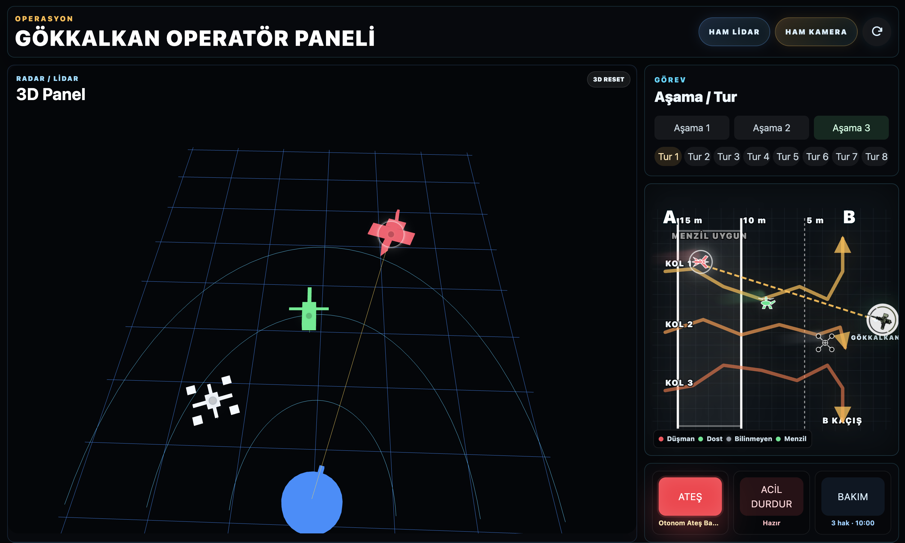
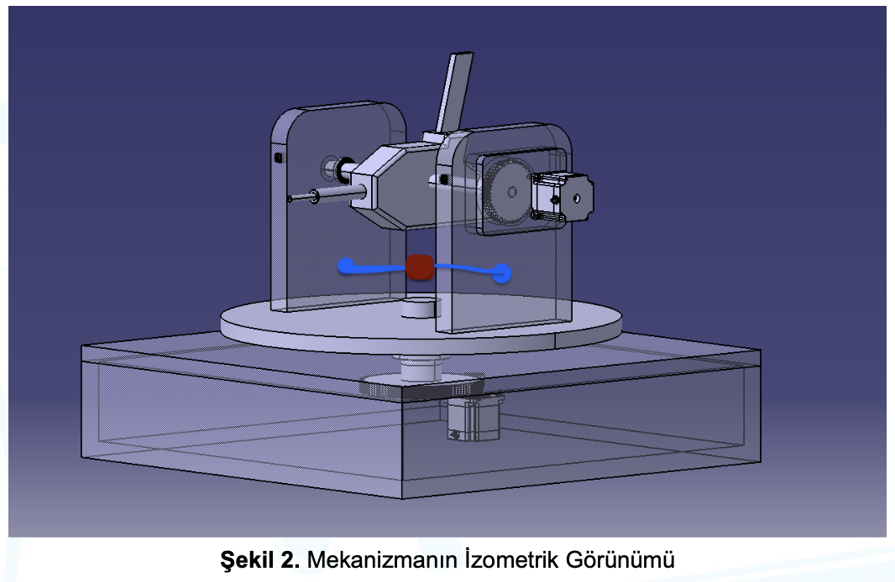
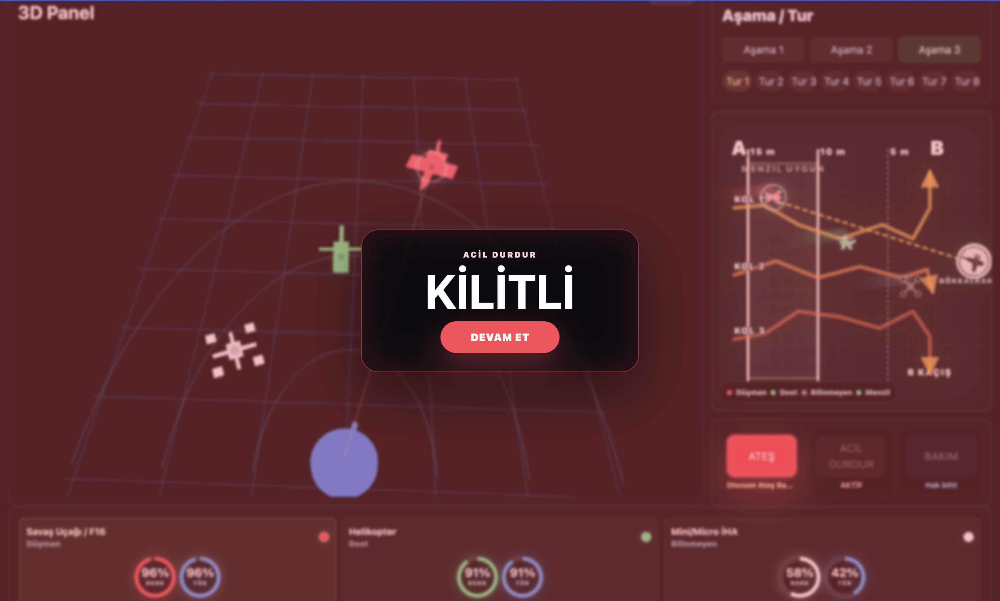
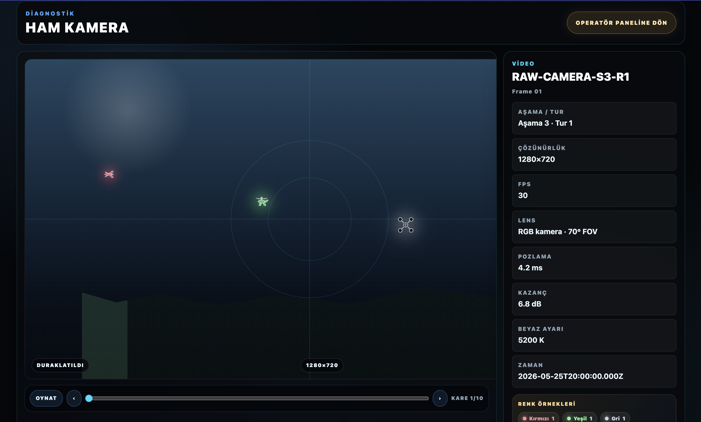
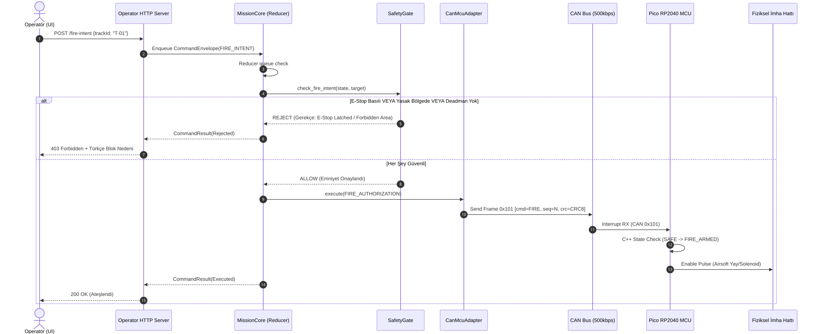
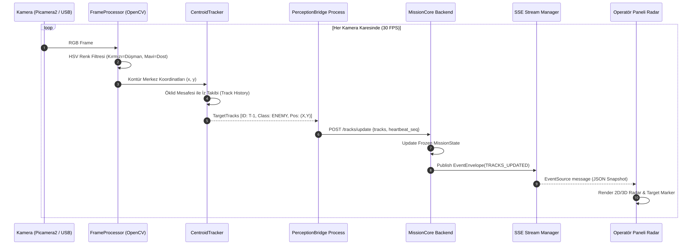

# Gökkalkan Kod Tabanı, Mimari ve Kapsamlı Eğitim Kılavuzu (Masterclass Edition)

> **Amaç:** Bu doküman, Gökkalkan yazılım sistemini; katmanlı mimarisini, kod modüllerinin detaylarını, veri akış yollarını, güvenlik kapılarını, USB MCU sözleşmesini ve matematiksel alt yapısını **gerçek arayüz ekran görüntüleri, CAD çizimleri, Mermaid diyagramları ve anlaşılır matematiksel ifadelerle** en ince ayrıntısına kadar açıklayan ana eğitim rehberidir.

---

## 📸 1. Gerçek Operatör Paneli ve Taret Görselleri

### A) Gerçek Operatör Paneli Konsolu (Aşama 3 - Dost/Düşman Görünümü)
Aşağıdaki görsel, [`frontend/`](../frontend) içerisinde yer alan canlı **Operatör Paneli Konsolu** ekran görüntüsüdür. Algı katmanında izlenen hedefler (Kırmızı Düşman / Mavi Dost), menzil kapıları, aşama bilgileri ve donanım sağlık rozetleri yer almaktadır:



---

### B) Mekanik Taret CAD Tasarımı ve LiDAR Yerleşimi
Taretin yaw (sağa-sola) ve pitch (yukarı-aşağı) eksenleri ile **Benewake TFA50-L LiDAR** sensörünün merkezî köprü üzerindeki mekanik konumu:



---

### C) Acil Durdur (E-Stop) Kilit Arayüz Görünümü
Fiziksel veya yazılımsal Acil Durdur tetiklendiğinde arayüzün kilitlenme ve uyarı ekranı:



---

### D) Kamera ve 1D LiDAR Operatör Görünümü
Perception katmanının gerçek MJPEG kamera akışı Aşama 1 nişan yüzeyinde gösterilir:



TFA50-L bir 2D tarama sensörü olmadığı için ayrı bir ham LiDAR haritası veya
point-cloud sayfası yoktur. Boresight menzili, kamera/taret ekseniyle birlikte
Aşama 1 panelinde canlı sayısal değer olarak gösterilir. Eski
`ktr_ham_lidar.png` görseli güncel operatör yüzeyini temsil etmez.

---

## 🏛️ 2. Bölüm: Kuşbakışı Sistem Mimarisi ve Katman Şeması

Gökkalkan sistemi, donanım bağımlılığı ile kullanıcı denetimi arasındaki güvenlik sınırlarını tam olarak ayıran **4 Katmanlı (Layered Architecture)** bir yapıya sahiptir:



> [!NOTE]
> UI doğrudan motor veya ateşleme hattına erişemez. UI yalnız yüksek seviyeli komut niyeti gönderir; komut `MissionCore` kuyruğuna girer ve `SafetyGate` onay verirse donanıma iletilir.

---

## 🔬 3. Bölüm: Backend Modüllerinin Derinlemesine İncelemesi

[`backend/src/gokkalkan_backend/`](../backend/src/gokkalkan_backend) altındaki ana Python modülleri ve görevleri:

### 1. `operator_api.py` — Görev Çekirdeği ve Operatör Servisi
- **[`OperatorService`](../backend/src/gokkalkan_backend/operator_api.py)**: Dış dünya (HTTP API) ile backend görev durum makinesi arasındaki ana servistir.
- **[`MissionCore`](../backend/src/gokkalkan_backend/operator_api.py)**: Sistem durumunun (`MissionState`) **tek yazarıdır (single-writer thread)**.
- **[`MissionState`](../backend/src/gokkalkan_backend/operator_api.py)**: Dondurulmuş (`frozen=True`) veri sınıfıdır. Race condition riski sıfırdır.
- **[`CommandEnvelope`](../backend/src/gokkalkan_backend/operator_api.py)** & **`EventEnvelope`**: Sürümlü, zaman damgalı (`run_id`, `sequence`, UTC timestamp) komut ve olay zarflarıdır.

```python
# Örnek MissionState yapısı (Dondurulmuş veri sınıfı)
@dataclass(frozen=True, slots=True)
class MissionState:
    mode: Mode
    stage: Stage
    estop_latched: bool
    armed: bool
    selected_track_id: str | None
    tracks: tuple[TargetTrack, ...]
    hardware_health: HardwareHealth
```

---

### 2. `safety_gate.py` — Fonksiyonel Emniyet Katmanı
- **Sıfır I/O Yan Etkisi:** Güvenlik kararları saf (pure) fonksiyonlar üzerinden verilir. Veritabanına veya donanıma doğrudan erişmez.
- **[`ForbiddenZone`](../backend/src/gokkalkan_backend/safety_gate.py#L18)**: Harekete yasak alan (`motion_zones`) ve atışa yasak alan (`fire_zones`) açısal sınırlarını kapsayıcı (`inclusive`) olarak tanımlar.
- **[`SafetyInputs`](../backend/src/gokkalkan_backend/safety_gate.py#L47)**: Karar anındaki tüm sensör, mod, konum ve kilit durumunu dondurulmuş bir snapshot olarak toplar.
- **[`evaluate_safety()`](../backend/src/gokkalkan_backend/safety_gate.py#L92)**: Girdileri değerlendirir; en ufak eksiklikte veya ihlalde **Fail-Closed** olarak komutu reddeder.

---

### 3. `runtime_mode.py` & `runtime_config.py` — Çalışma Modu ve Kilitler
- **[`RuntimeMode`](../backend/src/gokkalkan_backend/runtime_mode.py)**: `SIM` (Simülatör), `HIL` (USB seri loopback/safe-load), `LIVE` (Fiziksel Saha).
- **Fail-Closed `LIVE` Kilidi:** `LIVE` modu konfigürasyonda varsayılan olarak `enable_live = false` olarak gelir. Fiziksel interlock ve ön kontrol kanıtı olmadan CLI bayrağıyla dahi açılamaz.
- **`SAFE-001` İstemci Override Engelleyici:** İstemciden gelen payload içinde `dryRun: false` bayrağı gelse bile sunucu kendi güvenlik profiline göre hareket eder.

---

### 4. `tfa50_l.py` — Benewake TFA50-L LiDAR Sürücüsü
- **Protokol:** 9 baytlık UART çerçevesi (`115200 baud`).
- **[`TFA50LDecoder`](../backend/src/gokkalkan_backend/tfa50_l.py)**: `0x59 0x59` başlığını doğrular, cm değerini metreye çevirir, sinyal kalitesi ve çip sıcaklığını okunur.

---

### 5. `hardware_adapter.py` — Donanım Sürücü Soyutlaması
- **[`HardwareAdapterBase`](../backend/src/gokkalkan_backend/hardware_adapter.py)**: Donanım adaptörlerinin türediği soyut taban sınıftır.
- **[`DryRunHardwareAdapter`](../backend/src/gokkalkan_backend/hardware_adapter.py)**: Geliştirme modu adaptörü; donanım çağrılarını simüle eder.
- **[`UsbSerialMcuAdapter`](../backend/src/gokkalkan_backend/usb_serial_adapter.py)**: Pi ile Pico arasında USB CDC Serial kullanır; COBS+CRC16 framing, heartbeat, ACK/NACK ve fail-closed reconnect uygular.
- **[`CanMcuAdapter`](../backend/src/gokkalkan_backend/hardware_adapter.py)**: Eski CAN testleri ve tarihsel payload uyumu için korunur; aktif LIVE taşıması değildir.

---

### 6. `operator_http_server.py` — REST API ve SSE Canlı Yayın
- **REST Endpoints:** `/manual-aim`, `/fire-intent`, `/tracks/update`, `/estop`, `/estop/reset`, `/arm/hold`, `/telemetry/export`, `/replay`.
- **Server-Sent Events (`GET /state/stream`):** UI sürekli REST polling yapmak yerine backend'den canlı `MissionState` snapshot'larını milisaniyelik gecikmeyle dinler.

---

### 7. `telemetry_log.py` & `telemetry_recorder.py` — Otantik Olay Kaydı
- **Single-Writer Thread:** Olaylar SQLite WAL indeksi ve JSONL dosyalarına tek thread üzerinden yazılır.
- **Kriptografik Bütünlük:** Oturum kapatıldığında SHA-256 hash'li session manifesti üretilir. `gokkalkan replay verify` komutu ile kaydın değiştirilmediği doğrulanır.

---

## 🧠 4. Bölüm: Perception (Görsel Algı) Modülünün Derinlemesine İncelemesi

[`perception/`](../perception) klasörü altındaki algı sistemi:

```text
Kamera (Picamera2 / USB) ──> frame_processor.py (HSV Renk Filtresi)
                                    │
                                    ▼
                         centroid_tracker.py (Öklid İzi)
                                    │
                                    ▼
                         perception_bridge.py (POST /tracks/update)
```

1. **[`camera_node.py`](../perception/src/camera_node.py)**: Raspberry Pi Camera Module 3 (`Picamera2`) varsa onu, yoksa varsayılan USB kamerayı (`OpenCV VideoCapture`) otomatik seçer.
2. **[`frame_processor.py`](../perception/src/frame_processor.py)**: Görüntüdeki Kırmızı (Düşman) ve Mavi (Dost) hedefleri HSV renk aralığı filtresiyle ayırır, kontür alanlarını bulur.
3. **[`frame_processor.py`](../perception/src/frame_processor.py)** içindeki takipçi: Kontür merkez noktalarını eşleyerek hedeflere benzersiz `track_id` atar.
4. **[`perception_bridge.py`](../perception/src/perception_bridge.py)**: Ayrı bir `systemd` process'i olarak çalışır. Backend'e düzenli olarak `POST /tracks/update` ve canlılık heartbeat'i gönderir. Heartbeat kesilirse backend algı hatasına geçer ve canlı arming kapatılır.

---

## ⚡ 5. Bölüm: Firmware & Donanım Simülasyonu (Pico & USB CDC)

- **[`firmware/pico/`](../firmware/pico/)**: Pico RP2040 C++ emniyet durum makinesi. Motor sürücülere STEP/DIR darbeleri üretir. Host C++ birim testleri `cmake/ctest` ile doğrulanır.
- **[`mcu_simulator.py`](../backend/hardware_mock/mcu_simulator.py)**: Tarihsel CAN payload regresyonlarını sanal kanalda çalıştıran masaüstü Pico simülatörüdür; aktif runtime taşıması USB loopback'tir.
- **[`usb_serial_mcu_protocol.md`](./usb_serial_mcu_protocol.md)**: Aktif USB CDC taşıma, framing ve heartbeat sözleşmesi.
- **[`can_icd_v1.md`](./can_icd_v1.md)**: Tarihsel payload kimlikleri ve test sözleşmesi.
  - `0x100`: Pan/Tilt Açı Komutu (RPi $\rightarrow$ Pico)
  - `0x101`: Ateşleme İzni (RPi $\rightarrow$ Pico)
  - `0x200`: MCU Durum Bildirimi (Pico $\rightarrow$ RPi)
  - `0x201`: Acil Durdur (E-Stop) Uyarısı (Pico $\rightarrow$ RPi)

---

## 🔄 6. Bölüm: Uçtan Uca Veri Akış Sequence Diyagramları

### A) Ateş Emri ve Emniyet Kontrol Akışı (Sequence Diagram)



---

### B) Görsel Algı ve Sensör Akış Şeması



> Varlık adı tarihsel olarak `perception_radar_sequence.svg` biçiminde kalmıştır;
> güncel çalışma sensörü kamera + TFA50-L 1D LiDAR’dır.

---

## ⚙️ 7. Bölüm: Yarışma Aşamaları ve Görev Durum Makinesi

Yazılımın görev mantığı [`docs/tech_stack.md`](./tech_stack.md) gereğince 3 temel aşamadan oluşur:



---

## 📐 8. Bölüm: Sensör ve Protokol Matematiksel Formülleri

### 1. Benewake TFA50-L LiDAR Mesafe Dönüşümü
TFA50-L sensöründen gelen 9 baytlık UART paketinde mesafe santimetre cinsinden iletilir:

- **Mesafe Formülü:** `Mesafe (m) = (Byte_2 + Byte_3 * 256) / 100`
- **Checksum Doğrulama:** `Checksum = (Sum(Byte_0 .. Byte_7)) % 256`

Sürücü Kodu: [`backend/src/gokkalkan_backend/tfa50_l.py`](../backend/src/gokkalkan_backend/tfa50_l.py#L40-L75)

---

### 2. Centroid Tracker Öklid Mesafesi ile İz Eşleme
Ardışık iki karede bulunan kontür merkezleri `(x1, y1)` ve `(x2, y2)` arasındaki Öklid mesafesi `d`:

- **Öklid Mesafesi:** `d = √((x2 - x1)² + (y2 - y1)²)`

Eğer `d <= d_eşik` ise eski `track_id` hedefe atanmaya devam eder; aksi takdirde yeni bir iz kimliği oluşturulur.

---

### 3. Aşama 3 Menzil Kapısı Matrisi

| Hedef Tipi | İzin Verilen Menzil (Mesafe d) | Puanlama Kuralı |
| :--- | :--- | :--- |
| **F16** | 10 m – 15 m arası | Yalnızca 10–15m arası imha puanlanır. |
| **Helikopter / Balistik Füze** | 5 m – 15 m arası | 5–15m arası imha puanlanır. |
| **Mini / Micro İHA** | 0 m – 15 m arası | Tüm menzillerde puanlanır. |
| **Dost Unsur (Mavi)** | **HER ZAMAN YASAK (0 m)** | Dost vurma durumunda ceza puanı verilir. |

---

## 🛠️ 9. Bölüm: Pratik Geliştirme ve Kodlama Rehberi

### Adım Adım Örnek: Operatör Paneline "Hızlı Tarama" Butonu ve Backend Endpoint'i Ekleme

#### 1. Adım: Backend Uç Noktasını Ekle ([`operator_http_server.py`](../backend/src/gokkalkan_backend/operator_http_server.py))
```python
# HTTP POST /quick-scan handler'ı ekle
elif self.path == "/quick-scan":
    body = self._read_json_body()
    command_id = self.service.enqueue_command(
        CommandEnvelope(
            command_type="QUICK_SCAN",
            payload={"speed": body.get("speed", 1.0)},
            source="HTTP_OPERATOR",
        )
    )
    self._send_json({"ok": True, "commandId": command_id})
```

#### 2. Adım: Mission Core Reducer'a Mantığı Tanıt ([`operator_api.py`](../backend/src/gokkalkan_backend/operator_api.py))
```python
if envelope.command_type == "QUICK_SCAN":
    if not self.safety_gate.can_scan(self.state):
        return self._reject_command(envelope, "Safety gate scan blocked")
    
    new_state = self.state.copy_with(mode="SCANNING")
    self._publish_state(new_state)
    return CommandResult.success(envelope.command_id)
```

#### 3. Adım: Frontend Arayüzüne Buton Ekle ([`OperatorPanel.tsx`](../frontend/src/OperatorPanel.tsx))
```tsx
export function QuickScanButton() {
  const handleScan = async () => {
    await fetch('/api/quick-scan', {
      method: 'POST',
      headers: { 'Content-Type': 'application/json' },
      body: JSON.stringify({ speed: 1.5 })
    });
  };

  return (
    <button onClick={handleScan} className="btn-primary">
      🔍 Hızlı Tarama Başlat
    </button>
  );
}
```

---

## 📑 10. Bölüm: Doğrulama ve Sağlık Komutları

```bash
# 1. Ortam sağlığını ve tanı kontrolünü çalıştır
npm run doctor

# 2. Hızlı backend ve arayüz smoke testini koştur
npm run dev:check

# 3. Tüm Python testlerini çalıştır (186 test)
npm run test:python

# 4. Frontend tip kontrolü ve testlerini koştur
npm run typecheck && npm run test:unit
```
