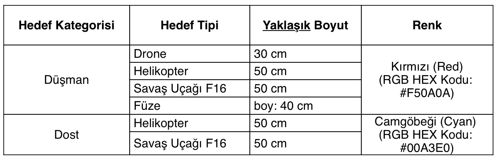
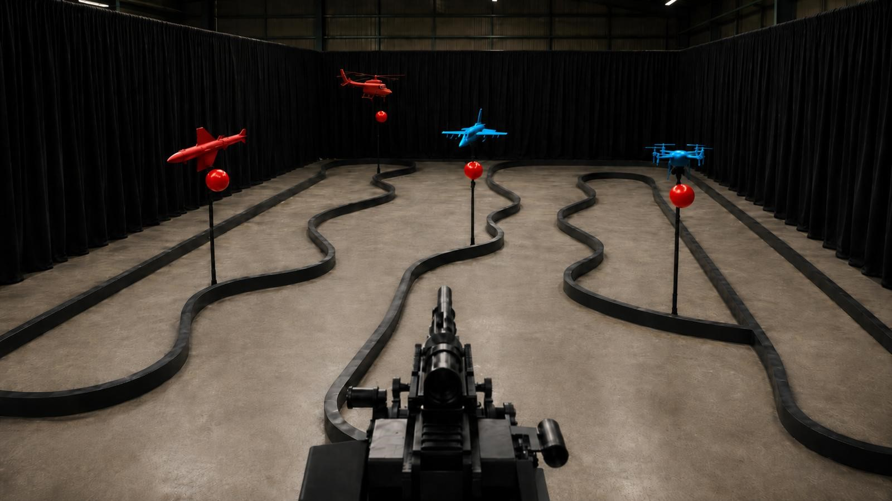

# Hedef ve Parkur Operasyon Güncellemesi

> **Kaynak durumu:** Bu belge, ekibin 8 Ağustos 2026 tarihinde repoya eklediği
> komite bilgilendirme metni ile iki bilgilendirme görselinin izlenebilir teknik
> özetidir. `docs/sartname_v4.pdf` bağlayıcı şartname olmaya devam eder. Sonraki
> tarihli resmî bir PDF/duyuru yayımlanırsa çelişkiler yeniden karşılaştırılmalıdır.

Kaynak görseller:

- [Hedef maket tablosu](images/hedef_maket_bilgileri.png)
- [Temsili siyah duvarlı parkur](images/temsili_parkur.jpg)
- [Şartname v4, fiziksel sayfa 14](sartname_v4.pdf#page=14)

## 1. Maket, renk ve balon sözleşmesi

| Aşama | Maket rengi ve tipi | Dost/düşman kararı | İmha noktası |
| --- | --- | --- | --- |
| Aşama 1 | Yalnız kırmızı maket; ilgili mesafelerde sıra rastgele | Gerekmez | Maketin altındaki kırmızı balon |
| Aşama 2 | Yalnız kırmızı drone ve/veya füze planlanıyor | Gerekmez | Maketin altındaki kırmızı balon |
| Aşama 3 | Kırmızı düşman; camgöbeği dost | **Maket rengi** | Seçilen düşman maketle ilişkilendirilmiş kırmızı balon |

- Düşman rengi: kırmızı `#F50A0A`.
- Dost rengi: camgöbeği `#00A3E0`.
- Bütün maketlerin altındaki balon kırmızıdır. Balon çapı yaklaşık `12–16 cm`
  olup değişebilir.
- Maket yalnız teşhis içindir; hedefin imha edilmiş sayılması balonun
  patlatılmasına bağlıdır.
- **Kritik sonuç:** Kırmızı bir blob tek başına düşman kanıtı değildir. Aşama 3'te
  dost maketin altında da kırmızı balon vardır. Ateş nişan noktası, düşman olduğu
  doğrulanmış maket ile mekânsal/zamansal olarak ilişkilendirilmiş balon olmalıdır.
- Maketler kamera kesitini büyütmek için burunları hafif aşağı eğimli
  yerleştirilecektir. Kamera ve hedef referans merkezi aynı yükseklikte kabul
  edilir; üst yüzey görünümü kamera yüksekliğinden değil bu burun eğiminden gelir.
  Kesin açı bildirilmediğinden araştırma veri seti
  `4/6/8/10/12/14/16/18/20/24/28°` bucket'larını ve `±0.5°` jitter kullanır.
  Gerçek açı ayrı tutulduğu için komitenin daha sonra bildireceği aralık mevcut
  veriden tahribatsız seçilebilir.
- Hedef yaw'ı bağımsız varsayılmaz. Rota 1/3 için enlemesine `2.75/2.87/3.00 m`,
  Rota 2 için `0 m`; boylamasına `3–17 m` alınır ve
  `viewYawDeg = atan2(enlemesine, boylamasına)` ile hesaplanır.

### 1.1. Kesin CAD/maket boyutları

Bilgilendirme görselindeki değerler yaklaşık, `Modeller.3mf` içindeki mesh
ölçüleri ise bu çalışma için kesin üretim sözleşmesidir.

| Nesne | Kesin 3MF boyutu (mm) | En uzun eksen |
| --- | --- | ---: |
| Drone | `287.452 × 374.986 × 195.076` | `374.986 mm` |
| Helikopter | `392.467 × 582.673 × 178.363` | `582.673 mm` |
| F16 | `300.403 × 500.000 × 139.258` | `500.000 mm` |
| Füze | `105.132 × 218.899 × 500.000` | `500.000 mm` |

Sentetik varlık manifesti bu ölçüleri `VERIFIED`, ölçek katsayısını `1.0` tutar.

## 2. Parkur ve yükseklikler

- Parkur: `10 m × 16 m`.
- Şartnamedeki hedef mesafeleri değişmemiştir (`5/10/15 m` görev referansları).
- Hedefler yerden yaklaşık `1,30 m` yüksekte hareket eder.
- Sistem, yerden `0,60 m` yüksek masaya konur.
- Gökkalkan LiDAR/kamera köprüsünün mekanizma tabanına göre `0,70 m` optik
  merkez tasarımı korunursa dünya yüksekliği yaklaşık `0,60 + 0,70 = 1,30 m`
  olur. `0,70 m` kalibrasyon alanı dünya yüksekliği diye yorumlanmamalıdır.
- Parkur dışındaki geri dönüş bölgelerinde görüşü kesen güvenlik bariyerleri
  olacaktır. Algı/rota kestirimi yalnız poligon içindeki görünür eğri parçaya
  güvenmeli; çıkıştan sonra hedefi görmeye veya iz sürmeye çalışmamalıdır.
- Arka ve yan duvarlar siyahtır. Negatif veri; perde kıvrımı, parlama, ray,
  bariyer, stand ve gölgeleri kapsamalıdır.

## 3. Yazılım kararları

1. Aşama 1 sırası sabit bir tip dizisi olarak yetkilendirilmez. Operatör/algı
   o turda gözlenen rastgele sırayı kullanır; simülatördeki sıra yalnız örnektir.
2. Aşama 2 sentetik senaryoları yalnız Drone (`Mini/Micro İHA`) ve Balistik Füze
   tiplerinden oluşur; tip sınıflandırması ateş için şart değildir.
3. Aşama 3 dost maket tipleri Helikopter ve F16 ile sınırlandırılır.
4. Algı önce maketi tespit/sınıflandırır, sonra altındaki balonu aynı track ile
   ilişkilendirir. Maket dostsa ilişkili kırmızı balon da ateşe kapalıdır.
5. Dönüş sınırları yarışma anında istenebileceği için pan/tilt soft limitleri
   çalışma zamanı yapılandırmasından gelir. UI clamp tek otorite değildir;
   backend Safety Gate ve motor kontrolcüsü de aynı veya daha dar limiti uygular.
6. `0,4 m/s` yalnız değişebilir hız prior'ıdır. Takipten ölçülen hız ateş önleme
   hesabında önceliklidir; prior tek başına atış yetkisi vermez.

## 4. Açık fiziksel kabul kapıları

- 3MF'de doğrulanan maket ölçülerinin baskı toleransı; gerçek malzeme, matlık/parlama davranışı ve yarışma yerleşim eğimi.
- Balon merkezinin makete göre piksel/geometrik ofset dağılımı.
- Camera Module 3 gerçek intrinsics/extrinsics ve 5/10/15 m piksel boyutları.
- Taret pan/tilt kesin yarışma limitleri ve mekanik limit anahtarı doğrulaması.
- Kırmızı balon–camgöbeği dost maket ilişkilendirmesinin gerçek videoda yanlış
  düşman üretmediği test.

Bu kapılar tamamlanmadan sentetik başarı fiziksel entegrasyon başarısı sayılmaz.
