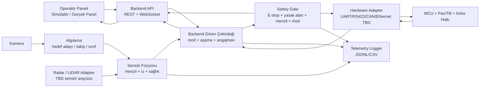
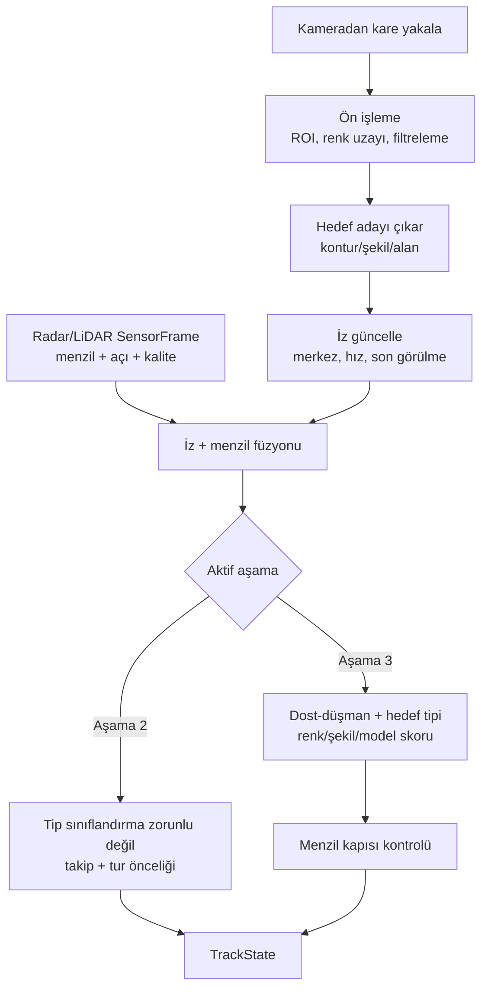
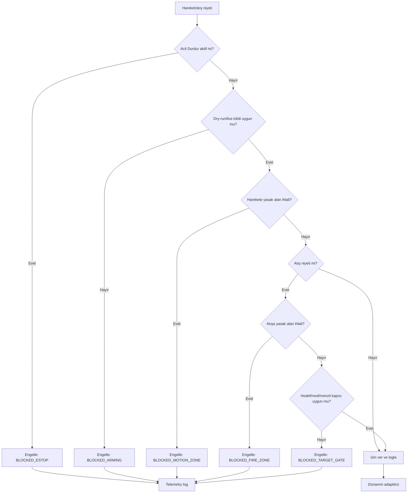
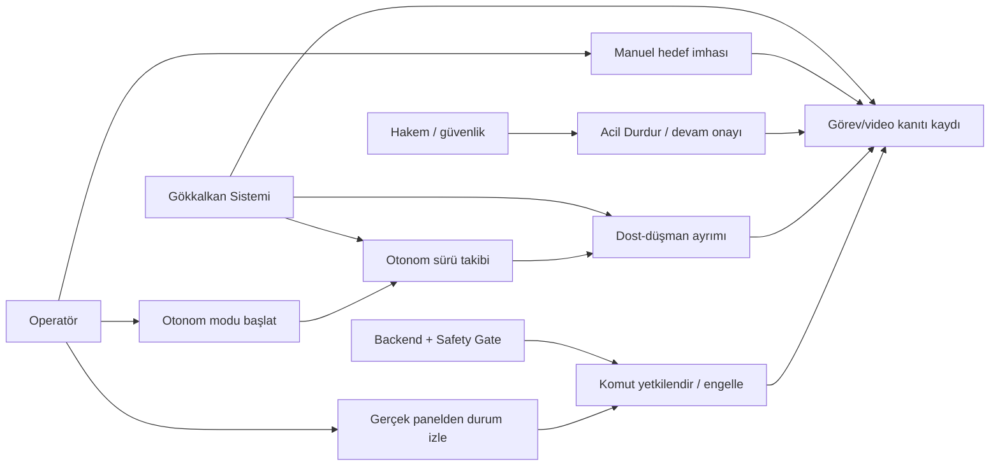
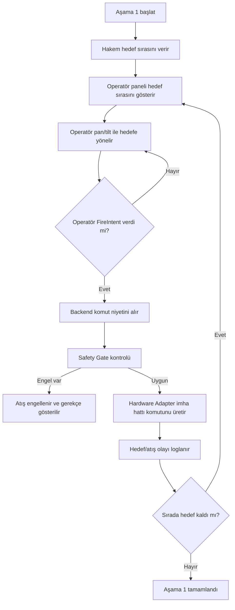
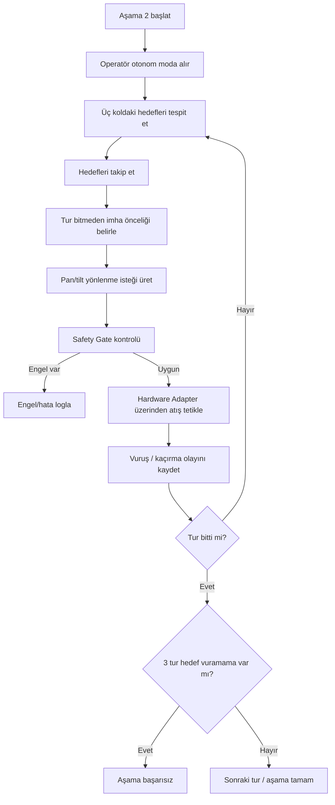
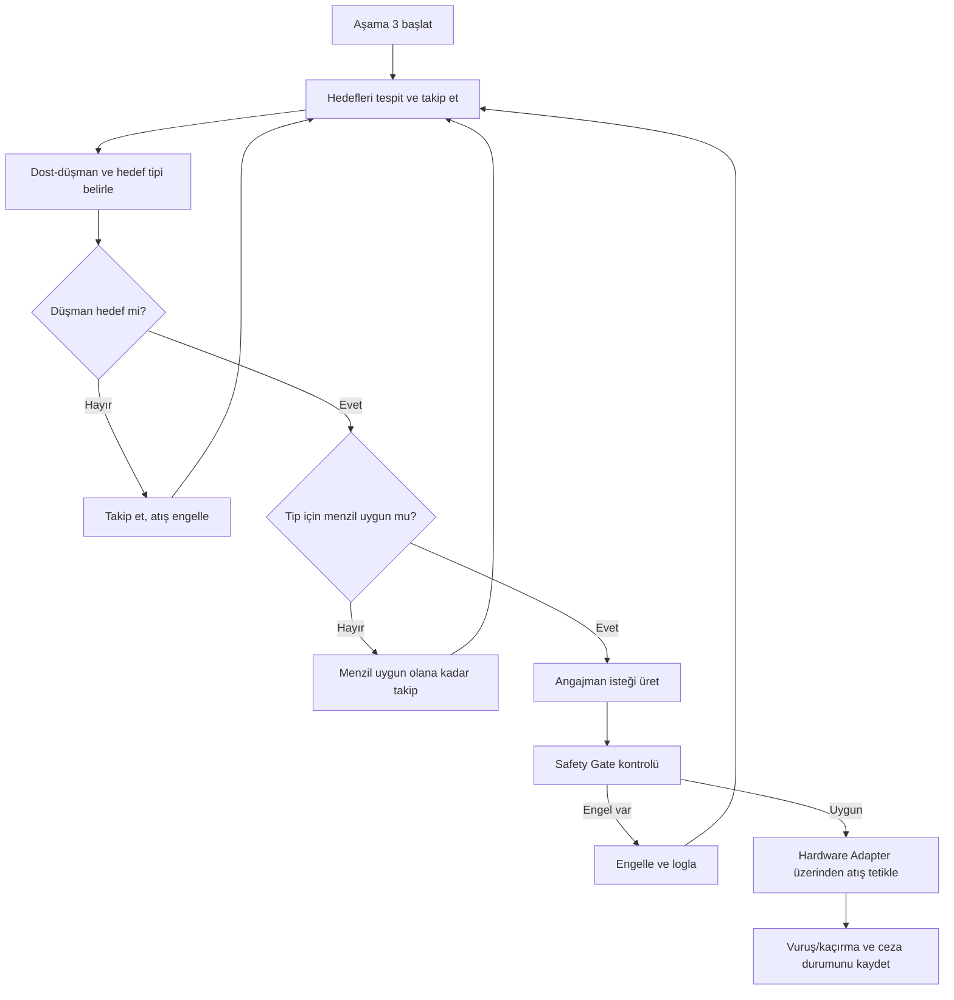
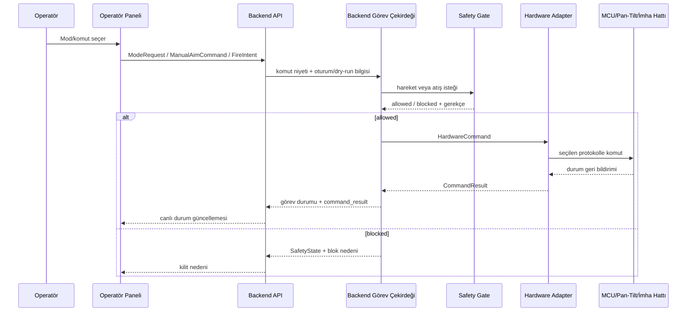
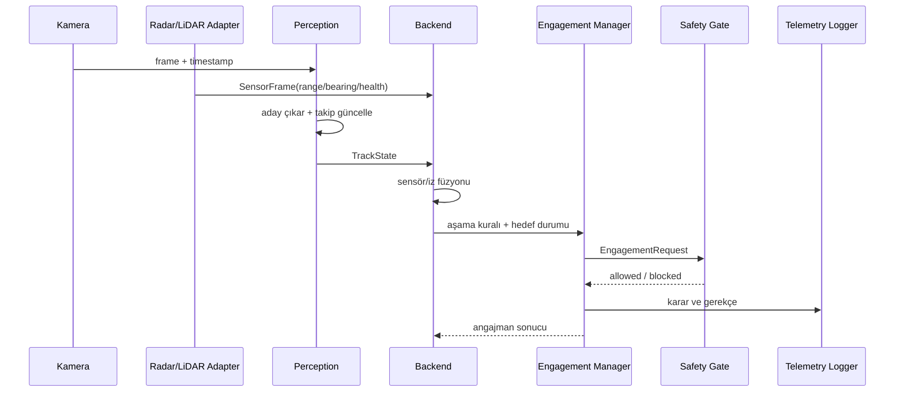
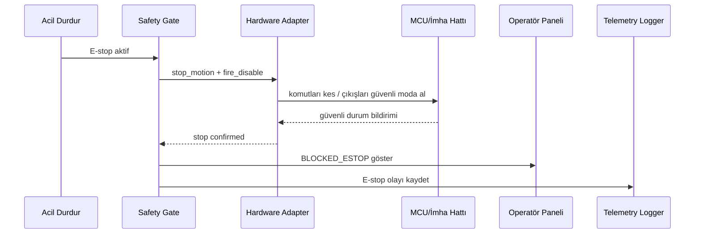

# KTR Mermaid Diyagramları

Bu dosyadaki Mermaid blokları KTR yazılım mimarisi, arayüz ve görev akışı bölümleri için kaynak olarak kullanılır. Diyagramlarda `Operatör Paneli` ifadesi bilinçli olarak teknoloji-nötr tutulmuştur: mevcut simülatör React/Vite’tır; gerçek panelin ilk önerisi de React/Vite + backend API’dir, fakat Safety Gate ve donanım yetkisi backend tarafındadır.

## Şekil 1 yazilim_blok_semasi

## Şekil 2 hedef_tespit_takip_akisi

## Şekil 3 - guvenlik-kapisi-akisi

## Şekil 4 - sistem-kullanim-durumu-diyagrami

## Şekil 5 - sistem_mod_durum_diyagrami

## Şekil 6 - asama1_manuel_akis

## Şekil 7 - asama2_otonom_takip_imha

## Şekil 8 - asama3_dost_dusman_menzil

## Şekil 9 - ui_backend_donanim_sekans

## Şekil 10 - perception_backend_safety_sekans

## Şekil 11 - acil_durdur_kesme_sekans

## KTR arayüz notu

Bu diyagramlar KTR’de aşağıdaki arayüz tablolarıyla birlikte kullanılmalıdır:

- kullanıcı arayüzleri: simülatör, gerçek operatör paneli, bakım/debug paneli,
- yazılımsal mesaj arayüzleri: `ModeRequest`, `FireIntent`, `SafetyState`, `TrackState`, `HardwareCommand`, `CommandResult`,
- sensör/veri arayüzleri: kamera, radar/LiDAR adapter, perception stream,
- elektronik arayüzler: güç, Acil Durdur, MCU haberleşmesi, imha hattı interlock.

Kesin gerilim, kablo, MCU protokolü veya radar/LiDAR mesaj formatı seçilmeden bu değerler resmiymiş gibi yazılmamalıdır.
