# KTR Mermaid Diyagramları

Bu dosyadaki Mermaid blokları `reports/ktr_v1.docx` içindeki şekil yer tutucularıyla birebir eşleşir.

## Şekil 1 yazilim_blok_semasi

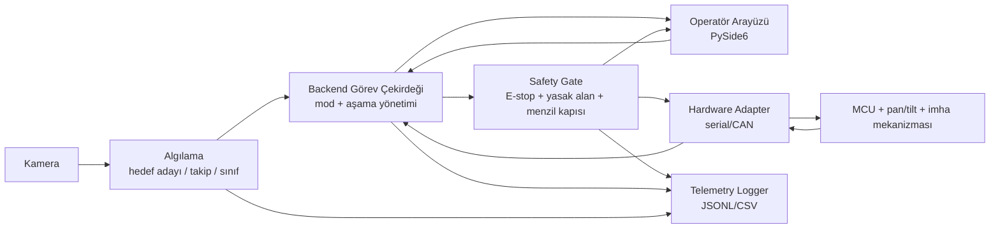

## Şekil 2 hedef_tespit_takip_akisi

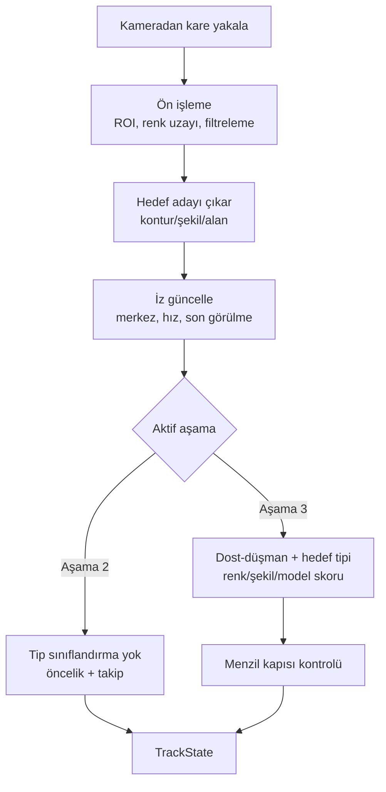

## Şekil 3 - guvenlik-kapisi-akisi

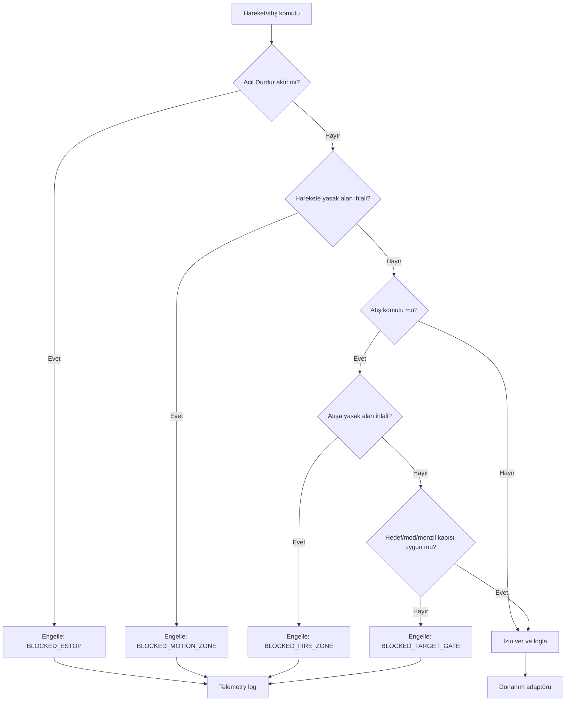

## Şekil 4 - sistem-kullanim-durumu-diyagrami

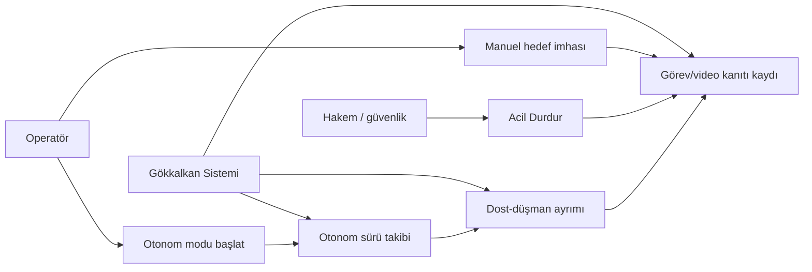

## Şekil 5 - sistem_mod_durum_diyagrami

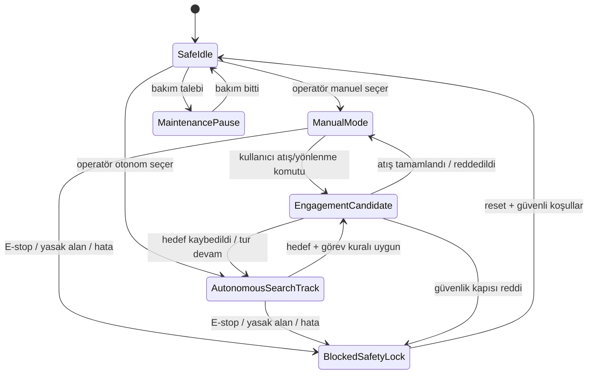

## Şekil 6 - asama1_manuel_akis

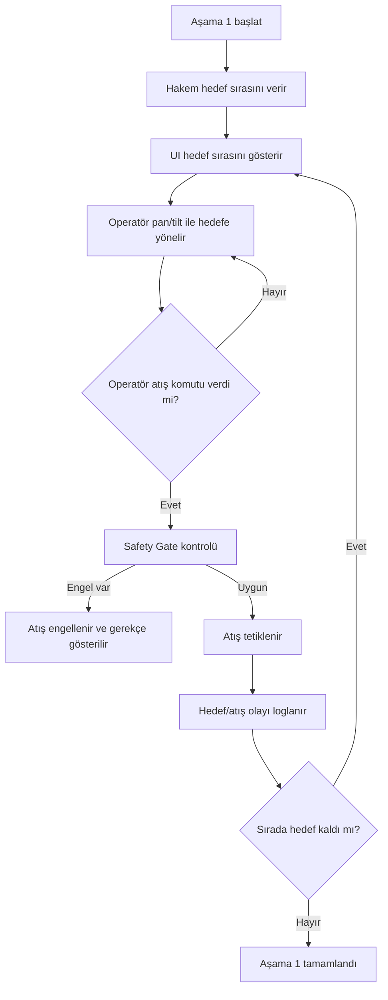

## Şekil 7 - asama2_otonom_takip_imha

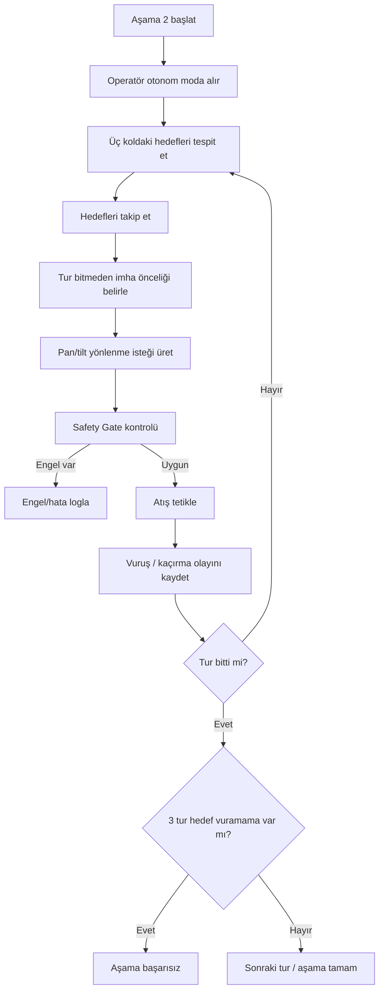

## Şekil 8 - asama3_dost_dusman_menzil

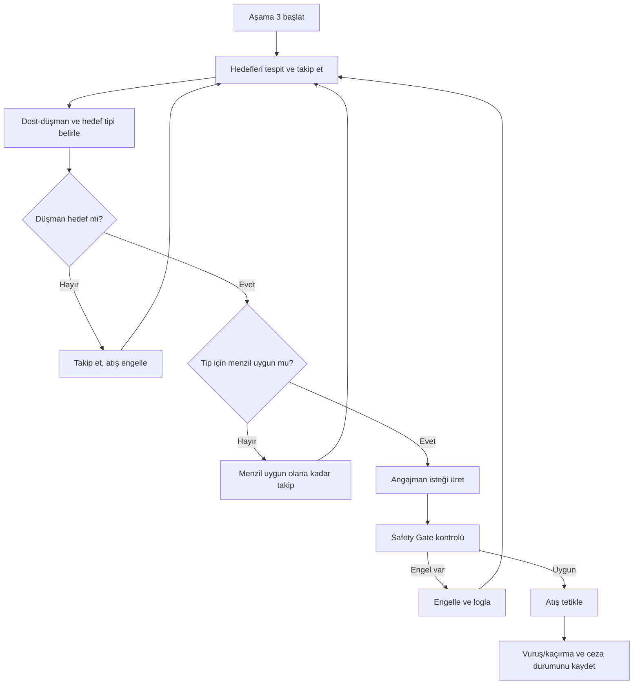

## Şekil 9 - ui_backend_donanim_sekans

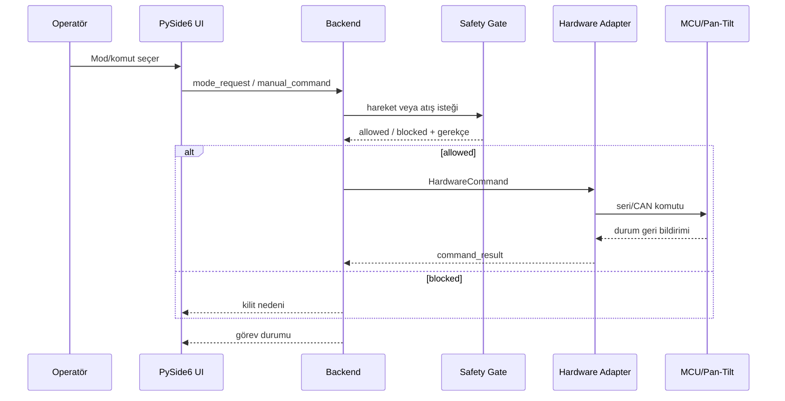

## Şekil 10 - perception_backend_safety_sekans

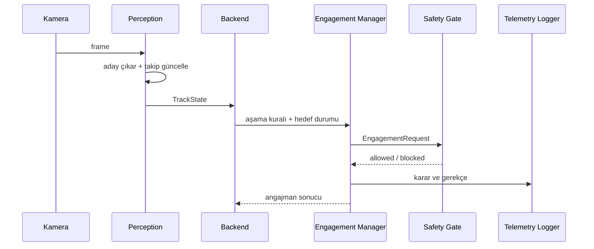

## Şekil 11 - acil_durdur_kesme_sekans

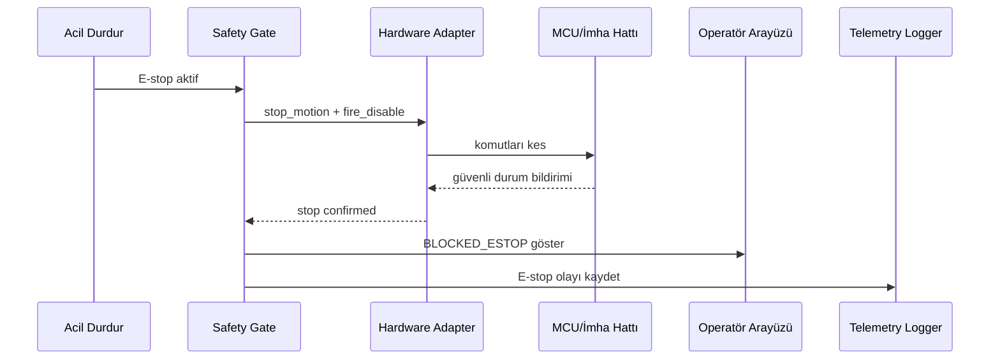
